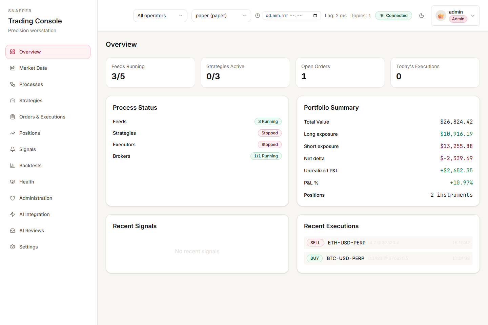
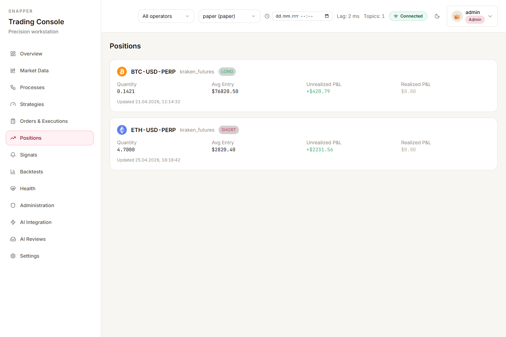
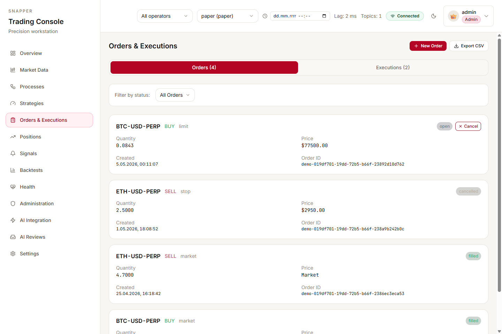
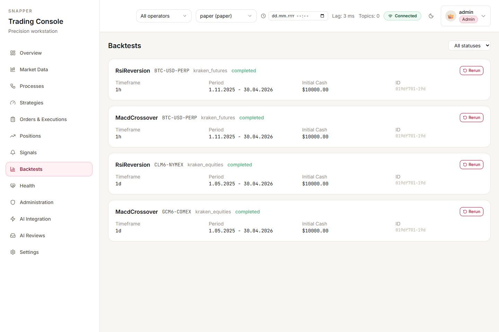
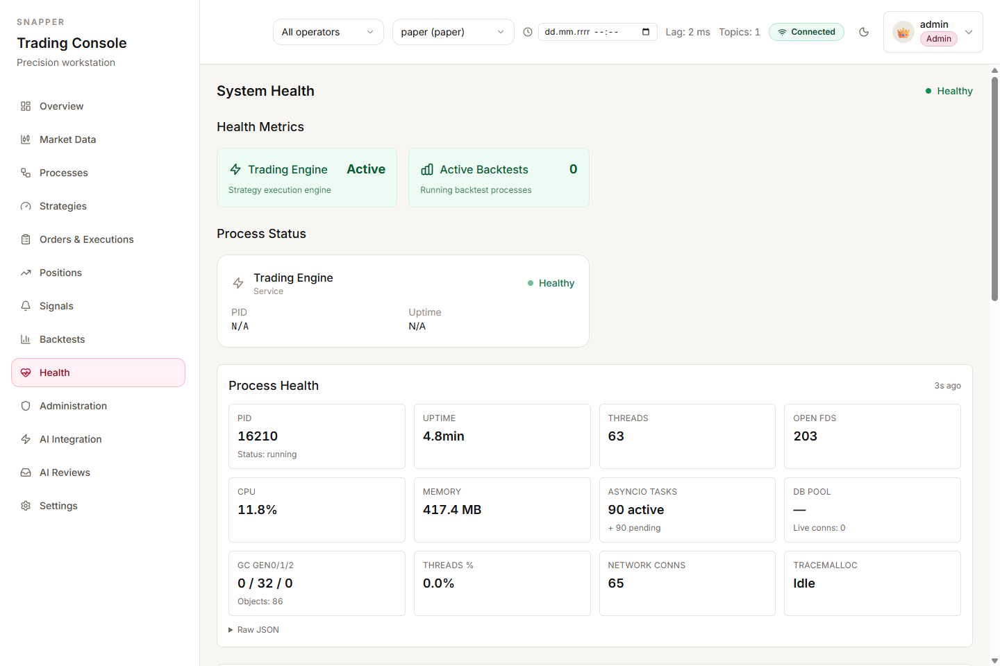
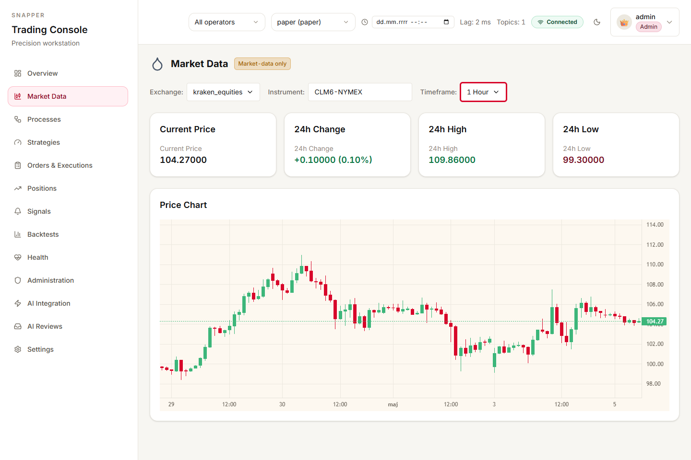
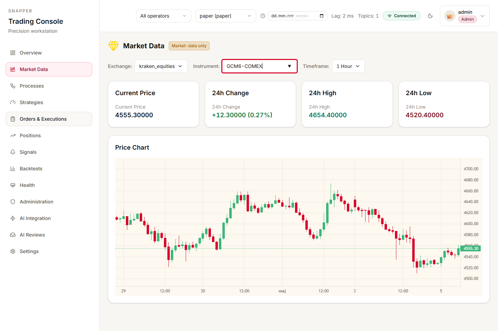
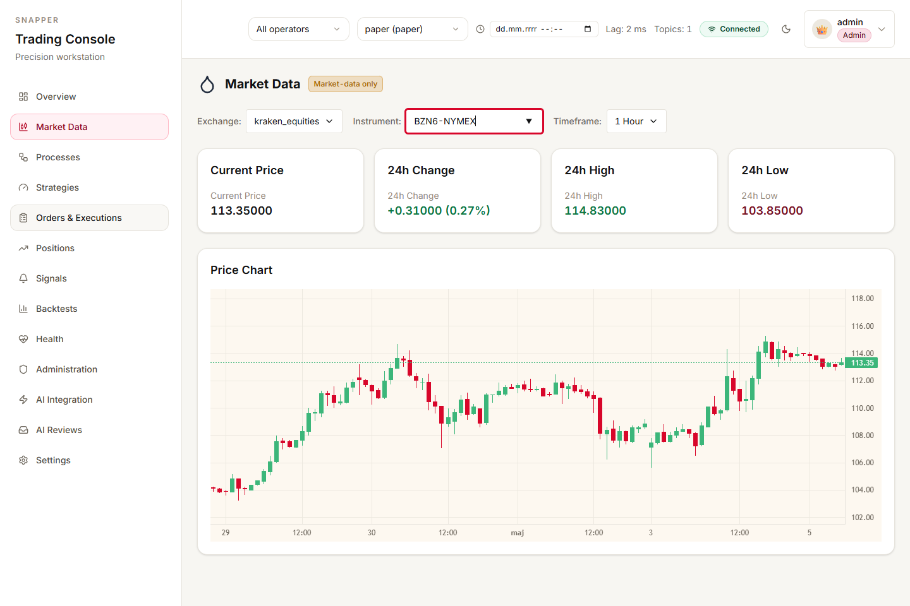
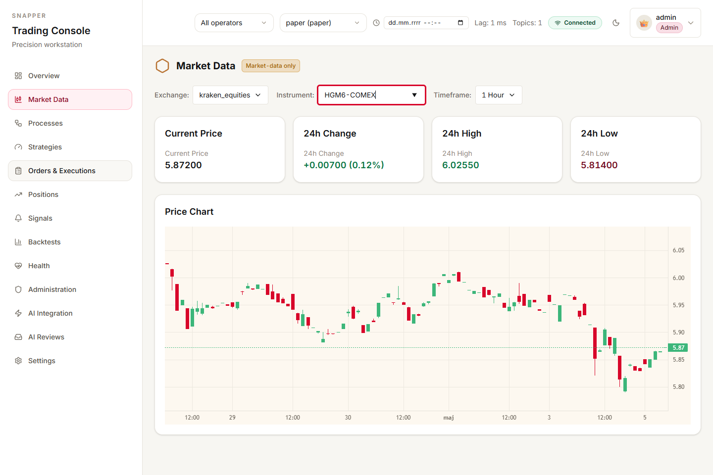
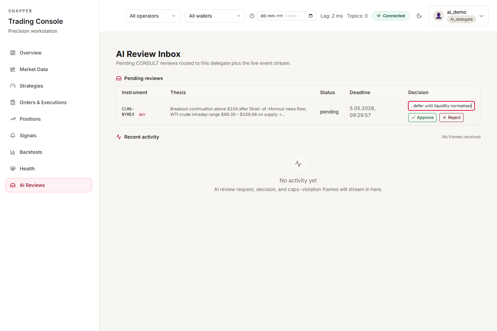

# Snapper Frontend

[](https://github.com/mateusz-klatt/snapper-frontend/actions/workflows/ci.yml)
[](https://github.com/mateusz-klatt/snapper-frontend/actions/workflows/gitleaks.yml)
[](https://sonarcloud.io/summary/new_code?id=mateusz-klatt_snapper-frontend)
[](https://sonarcloud.io/summary/overall?id=mateusz-klatt_snapper-frontend)
[](https://sonarcloud.io/summary/overall?id=mateusz-klatt_snapper-frontend)
[](https://sonarcloud.io/summary/overall?id=mateusz-klatt_snapper-frontend)
[](LICENSE)

Vite + React + TypeScript trading UI for the [Snapper](https://github.com/mateusz-klatt/snapper) platform.

## Scope and time-travel links

Wallet and operator query parameters in the URL hash remain authoritative during navigation,
browser history and reload. IDs are checked against the caller's readable access lists; explicit
`__all__` selections override saved IDs and survive reload. Scope writes preserve unrelated query
parameters and route subpaths.

`as_of` accepts an ISO timestamp with an explicit timezone and normalizes it to UTC. It updates both
the global time-travel state and API requests. A URL without `as_of` represents Live mode; the time
picker adds or removes this parameter. Invalid IDs or timestamps canonicalize to confirmed valid
state rather than substituting another saved wallet or inventing a historical moment.

Wallet changes refresh the session claim before operator, wallet and knowledge time are committed
together. Refreshes are serialized; superseded or unmounted selections cannot publish client
scope. A newer URL or picker decision wins, and refresh failure preserves the confirmed selection.

While a wallet change is pending, the picker shows the requested choice with a loading indicator.
The confirmed application scope stays unchanged until the session acknowledges the latest choice.
Choosing the previously confirmed wallet, including All wallets, supersedes a pending change.
Failed changes restore the confirmed choice and show an error; an older completion cannot clear a
newer pending choice.

Wallet feedback follows the same authoritative intentions as the refresh coordinator. A newer
wallet, operator or URL-scope intention immediately retires the older provisional choice and
error, even when the confirmed scope ultimately stays the same. A standalone knowledge-time
change preserves a still-current wallet attempt and its legitimate failure feedback. Login-state
or authenticated-user changes and unmounting retire local feedback. Intent observers cannot
interrupt the coordinator's refresh or acknowledgement fence if they fail or unsubscribe.
Each scope reservation keeps its own ticket before observers run, so a reentrant newer scope
selection keeps priority over the older caller.

Restored wallet scope is acknowledged by the authenticated session before dependent views mount.
Wallet-bearing and background refreshes share the same rotation coordinator. Failed hydration offers
an explicit retry; stale reads are retired before a new wallet rotation and cannot publish results
under an earlier scope.

Returning from Time Travel marks cached P&L windows stale without refetching the obsolete
historical observer. The Live window fetches fresh data when its scope becomes active; other
active reads continue to refresh.

## What it is

The browser-side dashboard for Snapper — a role-, wallet-, and operator-scoped portfolio + execution platform that talks to crypto, futures, equities, and forex venues over WebSocket and REST. This repo contains only the UI; the backend (FastAPI + SQLAlchemy + ZMQ) lives in the parent repo.

Highlights:

- **Smart-hybrid InstrumentIcon dispatcher** — text fallback first, vendored SVG when available, mixed-mode pair icons (e.g. SHIB-EUR shows text + EU flag).
- **Vendored crypto + flag icons** — 27 crypto + 24 flag SVGs in `public/icons/`. Zero CDN dependency, air-gap ready.
- **WalletPicker with HYBRID scope persistence** — URL params override localStorage override auto-pick first wallet. Reload survives.
- **Hash-based subroute routing** — `useHashSubpath` handles deep routes like `#backtests/<uuid>?wallet=X` without query-collision bugs.
- **WebSocket envelope minter** — per-app session ID, separate control / telemetry counters, ms-precision ISO-8601 provenance stamping.
- **Order entry** — bracket and trailing-stop dialogs with capability-guard error mapping.
- **Full operator surface** — overview, market, processes, strategies, orders, positions, signals, backtests, health, alerts, administration, AI integration, AI reviews, and settings.

The `viewer` role provides the operator read surface within its assigned scope. The `auditor` role
provides the administrator read surface across all wallets, users, desk memberships, scope grants,
credential summaries and settings. Administrative forms remain available for inspection, with their
save and destructive actions disabled. Auditors cannot change the shared account password. Local
display preferences and navigation remain interactive. The backend independently enforces the
permission boundary for HTTP requests and WebSocket commands; browser controls use the generated
permission catalog and preserve the existing presentation of sensitive values.

Backtests distinguishes failed list reads from a successful empty result. A read failure displays
an error and a **Retry** action; previously loaded runs remain visible if a refresh fails. Retry
repeats the list read and is available to read-only users without granting run-management actions.
List, detail, trades, signals and comparison caches include the selected wallet, operator and
knowledge horizon. A delayed response from an earlier scope cannot replace the selected view.

## Portfolio valuation

Overview preserves position counts and reports portfolio monetary totals and return percentages as
unavailable. The position projection does not establish a reporting currency, derivative contract
basis or account cash. Missing or non-finite valuation fields on open positions produce a coverage
warning and are never substituted with zero. Open **Positions**, then select **P&L Timeline** to
inspect reconstructed P&L in a chosen valuation currency with its coverage diagnostics. The
Overview link preserves the current wallet, operator and time-travel query parameters.

Live P&L keeps the last successful result visible with a loading indicator while the same selected
view refreshes. A new minute waits for the active read to finish; if more minutes pass, one follow-up
uses the latest minute. Changing the wallet, operator, valuation currency, granularity, time window
or knowledge horizon starts an isolated view. Signing out retires earlier results, including when
the same account signs in again. Coverage warnings remain visible during refreshes. Native position
prices and P&L retain their instrument currency and use display rounding to suppress floating-point
noise; stored values and calculations are unchanged.

## Market history

Global time travel selects the knowledge horizon for market history. The market scrubber selects
an independent business-time anchor, bounded by that horizon. Changing either reloads the chart;
historical views exclude live cache updates. Changing the chart timeframe preserves the replay
anchor. Cointegration diagnostics show their current state and carry a **Live** label.

Late finalized Live notifications are checked against HTTP history at a fresh knowledge horizon
before changing older bars. Confirmed corrections and gaps inside the loaded range are merged while
preserving the latest candle and chart position; global Time Travel and local replay remain isolated
from Live updates. If updates remain unconfirmed, the chart shows a warning. **Reload recent data**
chooses a new, bounded recent Live view; it does not claim that all earlier history has been repaired.

Shell subscriptions and the market chart retain separate dispatcher ownership. Returning from
Time Travel or rebuilding shell subscriptions keeps the market listener attached to the current
connection, so finalized candles continue to reach history reconciliation. Unmounting the market
retires its dispatcher; the next market mount receives a fresh instance. Replacing a connection
rebinds the active consumers to the new client. Shell setup still clears the process-metrics snapshot.

The shell applies global cache updates, alert notifications and process events once. The market
dispatcher observes candle notifications and retains buffered updates for replay after HTTP
snapshots; it does not repeat global event actions. Finalized older candles still reach the chart's
history reconciliation listener.

The statistics cards use closed one-minute candles for a full 24-hour window ending at the displayed
timestamp, independently of the chart timeframe. High and low use candle highs and lows; change
compares the final close with the close exactly 24 hours earlier. Both bounded range requests share
one explicit knowledge horizon. Missing, unfinished, invalid or conflicting minutes produce
unavailable statistics rather than synthetic returns. An exact latest closed price can remain
available when the rest of the window is incomplete. A zero baseline has no percentage return;
negative baselines use their absolute magnitude as the percentage denominator.

## Screenshots

Snapshots from a local instance running against the [snapper](https://github.com/mateusz-klatt/snapper) backend with a seeded paper-mode portfolio: long BTC-USD-PERP + short ETH-USD-PERP on Kraken Futures, four completed backtests spanning crypto and CME / NYMEX commodity futures, a multi-commodity 1h research panel (June WTI crude, June Gold, June Brent, June Copper), a Hormuz-driven AI review pending in the delegate inbox.





















## Getting started

Prerequisites: **Node 26+**, **pnpm 12.16.1** (pinned by `packageManager` in `package.json`; use Corepack to select it), a running Snapper backend at `http://localhost:8000`. If your Node installation does not provide Corepack, install Corepack before running the commands below.

```bash
corepack enable        # one-time, enables packageManager pnpm pin
pnpm install
pnpm dev               # vite dev server on http://localhost:3000
```

The dev server proxies `/api`, `/api/ws`, `/docs`, `/redoc`, and `/openapi.json` to the backend at `http://localhost:8000` — same-origin, no env-var configuration required. Bind to LAN with `make dev-lan` (binds `0.0.0.0:3000`) when you need to access the dev server from another device.

Other useful targets:

```bash
make typecheck    # tsc --noEmit
make lint         # eslint, fails on any warning
make test         # vitest run
make cov          # Vitest + executable-script coverage (100% threshold)
make check-all    # lint + format + typecheck + test + dead-code + cov + build
```

Before opening / pushing a PR, run the local prepush checks:

```bash
pnpm prepush      # format:check + lint + typecheck + no-comments + i18n + test:coverage
pnpm prepush:fix  # auto-fix format + lint, then typecheck + no-comments + i18n + test:coverage
```

`prepush` also checks strict comment policy and i18n, but does not run CI's
dead-code, build, or bundle-size checks. Run `make check-all` and
`pnpm bundle:check` as well to cover those stages.

## Generated types

The following files are generated from the Snapper backend's OpenAPI / WebSocket / Pydantic / RBAC schemas and committed so the repo builds out of the box:

- `src/types/api.generated.ts` — OpenAPI → TypeScript (regenerable here via `make gen`)
- `src/types/ws.generated.ts` — WebSocket JSON Schema → TypeScript (regenerable here via `make gen` when a schema export is supplied)
- `src/types/entities.generated.ts` — backend Pydantic entity models (regenerated upstream by the backend; ship as committed contract)
- `src/types/permissions.generated.ts` — backend RBAC permission catalog (regenerated upstream by the backend)
- `src/lib/schemas/api.generated.zod.ts`, `ws.generated.zod.ts` — runtime Zod validators derived from the same schemas (regenerated upstream)

To refresh the OpenAPI/WS subset against a running backend at `http://localhost:8000`:

```bash
make gen
```

OpenAPI is fetched from the backend. WebSocket generation additionally needs
`build/ws-schemas.json`, or `WS_SCHEMAS_PATH=/path/to/ws-schemas.json make gen`;
the script skips that step when no exported schema is available.

The full set is regenerated by the backend (it owns the `Pydantic` and RBAC sources); pull the regenerated files into a PR when you bump the submodule pointer in the parent monorepo. See `scripts/gen-from-backend.mjs` for the public-side flow.

## Vendored icons

`public/icons/crypto/` and `public/icons/flags/` are vendored SVGs (no runtime CDN). To re-vendor or add new icons:

```bash
pnpm icons:vendor
```

Sources are tracked in `scripts/vendor-icons.mjs` and the manifest is regenerated at `src/components/InstrumentIcon/iconManifest.generated.ts`.

## Architecture notes

- **Smart-hybrid dispatch tiers** — Tier 1 vendored single-asset SVG, Tier 2 mixed pair (text base + vendored quote flag, or vice versa), Tier 3 text fallback. Rules spelled out inline in `src/components/InstrumentIcon/types.ts`.
- **`taxRules.ts`** — Polish PIT / DE / FR cost-basis rules cite their source statutes (Ustawa o PIT art. 17 ust. 1f pkt 11, KIS interpretation lineage, EU equivalents). Update with caution; tax-treatment changes need legal review.
- **`useHashSubpath`** — strips `?query` before splitting on `/`, fixing the deep-route + scope-query collision (e.g. `#backtests/<uuid>?wallet=X` correctly returns `["<uuid>"]` not `["<uuid>?wallet=X"]`).

## Release contract (1.0+)

Stable from `1.0.0` onward; subsequent releases follow Semantic Versioning:

- **`MAJOR` (`2.0.0`, `3.0.0`, …)** — breaking changes to user-facing UI flows or to the assumed backend API/WebSocket contract. Breaking changes are announced in `CHANGELOG.md` and accompanied by an `UPGRADING-N.md` note.
- **`MINOR` (`1.1.0`, `1.2.0`, …)** — new screens, new feature surfaces, new accepted backend frames. Backwards-compatible by default.
- **`PATCH` (`1.0.1`, …)** — bug fixes, accessibility tightening, security patches. No behaviour changes for existing flows.

### Supported runtime

- **Browsers** — current and previous major release of Chrome, Edge, Firefox, Safari (two major versions in total). This is the support target. The `ci.yml` workflow runs Node-based checks, and `e2e.yml` builds the production bundle and runs Playwright Chromium tests. These workflows do not test a matrix of every supported browser and major version. Open an issue if you hit a regression in scope.
- **Node + pnpm (for contributors)** — Node `>=26`; use the pnpm `12.16.1` package-manager pin. The package's declared pnpm minimum is `>=11`.
- **Backend pairing** — this frontend release pairs with the `mateusz-klatt/snapper` backend at the submodule pointer recorded against the matching frontend tag. Generated types (`src/types/*.generated.ts`, `src/lib/schemas/*.generated.zod.ts`) are committed; regenerate with `make gen` against a local backend if you point at a different commit.

### Accessibility target

Targets **WCAG 2.1 AA** for the shipped UI flows (login, navigation, market data, orders, backtests, modals). The picker controls follow the W3C ARIA APG combobox/listbox pattern. Found a regression? File an issue with reproduction + screen reader/version.

### Internationalisation

The UI uses i18next catalogs with 45 picker locales. Locale choice is stored in `localStorage` as `snapper-locale`, falls back through supported browser language and script preferences to the default locale, and updates `<html lang>` / `<html dir>` for RTL languages. Date, number, and financial formatting use the selected locale. The financial color convention defaults from locale (`rising-red` for CN/HK/JP/KR, Western green-up elsewhere) and can be overridden in Settings.

Authenticated locale changes also persist the catalog language to the backend
account's `default_language`. Login applies the account language to i18next
when the backend supplies one.

### Privacy + storage

The frontend does not load third-party trackers, analytics, or fonts. Local browser storage is limited to:

- `sessionStorage`: `snapper_sequence_tracker` (per-session UUIDv7 + per-table sequence counter, used for control-frame provenance). Cleared when the tab closes.
- `localStorage`: `snapper-auth` (persisted user profile only; tokens stay in backend-managed cookies), `snapper-dark-mode` (boolean), `snapper-locale` (locale code), `snapper-financial-color-preference` (`auto`, `rising-green`, or `rising-red`), and scope-persistence (last selected wallet/operator UUID strings).
- `cookies`: backend-issued auth + CSRF cookies. Lifecycle is owned by the backend.

No telemetry is sent from the browser. All network traffic goes to the same origin (`/api/*`, `/api/ws`).

### Self-hosting security guidance

When hosting `snapper-frontend` behind a reverse proxy (recommended), set:

- `Strict-Transport-Security: max-age=31536000; includeSubDomains` (HTTPS only)
- `Content-Security-Policy: default-src 'self'; img-src 'self' data:; style-src 'self' 'unsafe-inline'; connect-src 'self' wss:`
- `X-Frame-Options: DENY` (or CSP `frame-ancestors 'none'`)
- `X-Content-Type-Options: nosniff`
- `Referrer-Policy: strict-origin-when-cross-origin`

For HTTPS deployments, mark the backend's auth + CSRF cookies `Secure` + `HttpOnly` (auth) / `SameSite=Lax`.

### Deprecation policy

Public-facing features (UI flows, route paths, hash-subroute schemes, backend frame contracts) marked deprecated in a `MINOR` release will be removed in the **next** `MAJOR` release at the earliest. The `CHANGELOG.md` lists deprecations under a `### Deprecated` heading.

## Contributing

See [CONTRIBUTING.md](CONTRIBUTING.md). Forks welcome; PRs get reviewed against `master`.

## License

[Apache License, Version 2.0](LICENSE) — Mateusz Klatt, 2026. See [NOTICE](NOTICE)
for attribution. Vendored icons keep their original CC0/MIT terms in
[public/icons/LICENSE.md](public/icons/LICENSE.md).

Revisions through the `last-mit` tag were released under MIT. Subsequent original
work is licensed under Apache-2.0; earlier MIT grants remain valid.

### Bundled assets

- `public/TwemojiCountryFlags.woff2` — derived from [Twemoji](https://github.com/twitter/twemoji) via [`country-flag-emoji-polyfill`](https://github.com/talkjs/country-flag-emoji-polyfill). Twemoji graphics are licensed under [CC-BY 4.0](https://creativecommons.org/licenses/by/4.0/). Loaded only on browsers that lack native flag emoji (e.g. Windows Chrome/Edge); other platforms use their system flag glyphs.
